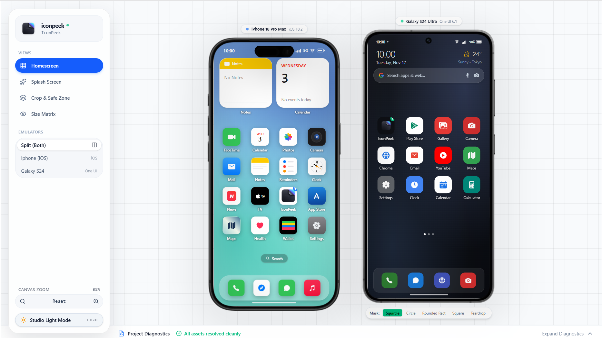
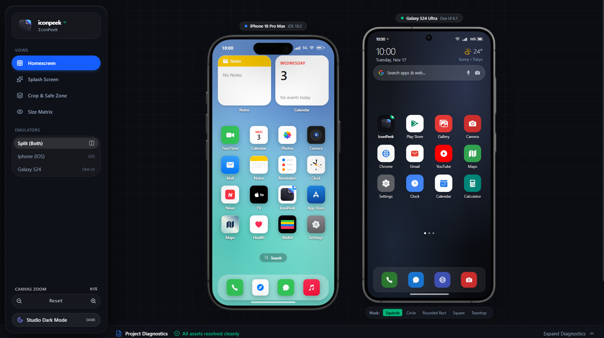
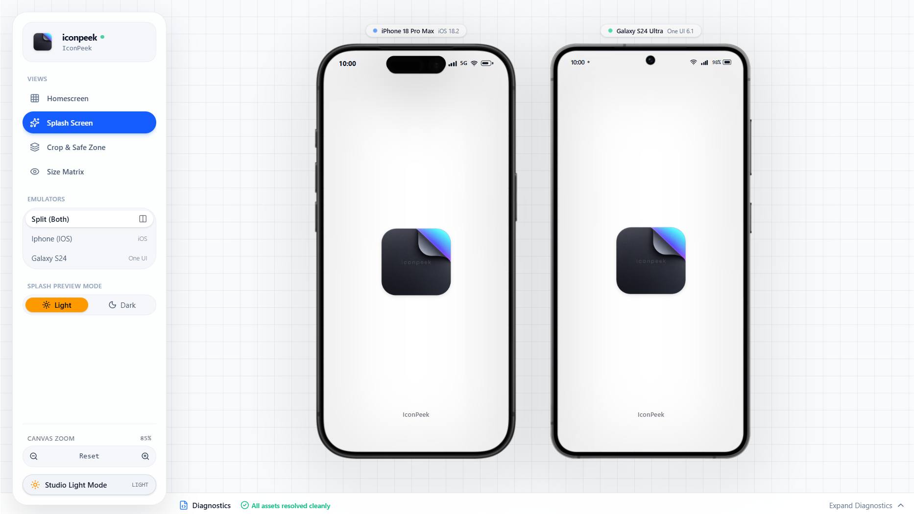
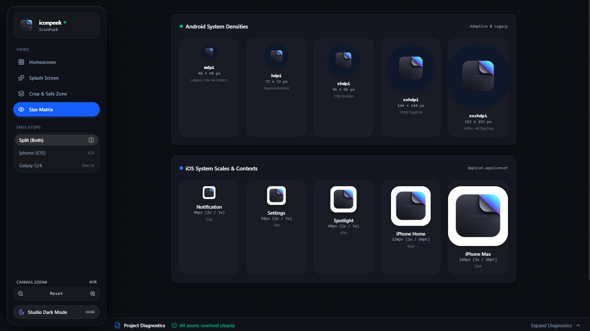

# iconpeek

<p align="center">
  
</p>

<p align="center">
  <strong>Zero-dependency local preview studio for Expo app icons and splash screens.</strong>
</p>

`iconpeek` is a lightweight, zero-dependency npm package I created to solve a problem I often faced when developing React Native and Expo apps: checking how app icons would actually look on Android and iOS. Instead of changing the icon, rebuilding the app, and reinstalling it just to check the results, I built a local preview tool that lets developers see their app icons directly in the browser using their existing Expo configuration. Simply run `npx iconpeek` inside your Expo project to start the preview server.

It includes previews for Android adaptive icons, different icon shapes, iOS home screen icons, app icon sizes, and light and dark splash screens. It also includes a Python-based icon generator that creates the required Android and iOS icon files. What started as a small tool to make my own development workflow easier became an npm package that helps other developers save time and avoid repeated builds when working on their app branding.

<p align="center">
  <a href="#quick-start">Quick Start</a> •
  <a href="#showcase">Showcase</a> •
  <a href="#key-features">Key Features</a> •
  <a href="#appjson-configuration">Configuration</a> •
  <a href="#cli-flags">CLI Flags</a> •
  <a href="#asset-generator-script">Asset Generator</a>
</p>

---

## Showcase

### 1. Dual Device Emulators (Light & Dark Studio)
Test your branding simultaneously on an **iPhone 18 Pro Max** (iOS 18.2) and **Samsung Galaxy S24 Ultra** (One UI 6.1). Switch between Studio Light and Dark modes to match your preferred workspace aesthetic.

| Studio Light Mode | Studio Dark Mode |
| :---: | :---: |
|  |  |

---

### 2. Interactive Splash Screen Simulation (Light & Dark Mode)
Click on any app icon or select the **Splash Screen** view to preview your app's launching sequence. Toggle between **Light** and **Dark** splash modes with automatic status bar contrast calculation (dark status bar on light backgrounds, white on dark backgrounds).

<p align="center">
  
</p>

---

### 3. Density & Size Comparison Matrix
Inspect your branding assets across all essential operating system contexts and screen pixel densities in one glance:

- **Android Densities (Adaptive & Legacy):** `mdpi` (48px), `hdpi` (72px), `xhdpi` (96px), `xxhdpi` (144px), and `xxxhdpi` (192px).
- **iOS Scales & Contexts (`AppIcon.appiconset`):** Notification (40px), Settings (58px), Spotlight (80px), iPhone Home (120px), and iPhone Max (180px).

<p align="center">
  
</p>

---

## Key Features

- **📱 Dual Ultra-Realistic Device Mockups**
  - **Apple iPhone 18 Pro Max (iOS 18.2):** Full Dynamic Island simulation, status bar icons, widgets, and iOS homescreen layout.
  - **Samsung Galaxy S24 Ultra (One UI 6.1):** Edge-to-edge Infinity-O punch-hole cutout, One UI clock/weather widget, and Google search bar.

- **🎨 Android Adaptive Icon Physics & Masks**
  - **Parallax Tilt Simulation:** Move your mouse over the Galaxy S24 icon to inspect foreground/background layer separation and depth.
  - **One-Click Mask Switching:** Switch between `Squircle`, `Circle`, `Rounded Rectangle`, `Square`, and `Teardrop` shapes.

- **🌗 Splash Screen Light & Dark Preview**
  - Seamless support for both `expo-splash-screen` config plugin and standard `expo.splash` definitions.
  - Test independent light and dark background colors and image assets.
  - Click anywhere on the splash screen or tap the bottom home bar to return to the homescreen.

- **📐 Safe Zone & Crop Inspector**
  - Inspect adaptive icons against the official Android 108dp canvas, 72dp viewport, 18dp crop margin, and 66dp safe zone.
  - Verify that critical logo artwork never gets cropped off across different vendor masks.

- **📊 Density & Size Comparison Matrix**
  - Instant density checks across iOS App Store, notification, settings, spotlight, and Android mdpi through xxxhdpi.

- **📲 Mobile-Responsive Studio**
  - Fully responsive on mobile phones and tablets with slide-out drawer navigation, top action bar, and automatic viewport-fitting zoom.

- **⚡ Hot Reload & Live Diagnostics**
  - Connected via Server-Sent Events (SSE). Modifying `app.json` or updating image assets refreshes the preview immediately.
  - Diagnostics drawer provides real-time feedback on mapped asset paths and configuration health warnings.

---

## Quick Start

Run this single command inside any Expo project root:

```bash
npx iconpeek
```

Or specify a custom project path or port:

```bash
npx iconpeek --project /path/to/expo/app --port 5000
```

---

## CLI Flags

| Flag | Default | Description |
| :--- | :---: | :--- |
| `--project <path>` | `.` | Target directory containing `app.json`, `app.config.json`, or `app.config.js`. |
| `--port <number>` | `4200` | Starting port. Automatically increments if the port is already in use. |
| `--no-open` | `false` | Start the local server without automatically opening the browser. |

---

## `app.json` Configuration

`iconpeek` automatically reads your standard Expo configuration:

```json
{
  "expo": {
    "name": "My Great App",
    "icon": "./assets/icon.png",
    "android": {
      "adaptiveIcon": {
        "foregroundImage": "./assets/adaptive-icon.png",
        "backgroundColor": "#FFFFFF"
      }
    },
    "plugins": [
      [
        "expo-splash-screen",
        {
          "image": "./assets/splash.png",
          "resizeMode": "contain",
          "backgroundColor": "#FFFFFF",
          "dark": {
            "image": "./assets/splash-dark.png",
            "backgroundColor": "#121212"
          }
        }
      ]
    ]
  }
}
```

> [!TIP]
> If your project uses the legacy `expo.splash` object instead of `plugins`, `iconpeek` supports that as well.

---

## Asset Generator Script (`generate_icons.py`)

A standalone icon generator script is bundled to produce production-ready Android and iOS icon sets from a single high-resolution master image (1024x1024 PNG).

### Prerequisites:
```bash
pip install Pillow
```

### Basic Usage:
```bash
python generate_icons.py --source master-icon.png --out ./icon_output
```

### Advanced Usage with Custom Layers:
```bash
python generate_icons.py \
  --source master-icon.png \
  --out ./icon_output \
  --android-fg ./assets/adaptive-fg.png \
  --android-bg "#0E1015" \
  --ios-source ./assets/ios-icon.png
```

### Generated Outputs:
* **Android:** Legacy mipmap densities (`mdpi` through `xxxhdpi`), `mipmap-anydpi-v26` adaptive XML configs, and 512x512 Google Play Store graphic.
* **iOS:** Complete `AppIcon.appiconset` with properly formatted `Contents.json` covering iPhone and iPad idiom sizes.

---

## Development & Testing

Run unit & smoke test suite:
```bash
npm test
```

Build production client assets:
```bash
npm run build
```

---

## License

MIT © [IconPeek](https://github.com/raceczn/expo-iconpeek)
